<p align="center">
  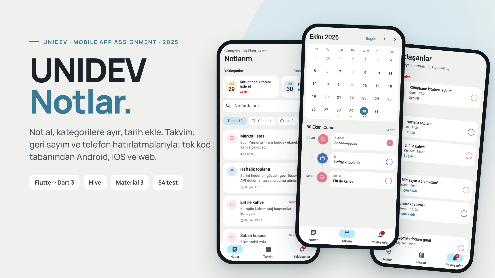
</p>

<p align="center">
  <b>UNIDEV Software &nbsp;·&nbsp; Mobile App Developer Assignment &nbsp;·&nbsp; 2025</b><br>
  <sub>My solution to UNIDEV's mobile developer take-home task, later rebuilt into a complete, tested app.</sub>
</p>

<p align="center">
  <a href="https://github.com/sayko89/UNIDEV---Mobile-Notes-App/actions/workflows/ci.yml"></a>
</p>

<h3 align="center">
  <a href="https://sayko89.github.io/UNIDEV---Mobile-Notes-App/?demo=1">▶&nbsp; Try it in your browser</a>
</h3>
<p align="center"><sub>The web demo opens with sample notes that live only in your browser tab. Without <code>?demo=1</code> it is the real app and saves to your browser.</sub></p>

<p align="center">
  <a href="#the-assignment">The assignment</a> &nbsp;·&nbsp;
  <a href="#screens">Screens</a> &nbsp;·&nbsp;
  <a href="#from-prototype-to-app">Prototype → app</a> &nbsp;·&nbsp;
  <a href="#how-it-works">How it works</a> &nbsp;·&nbsp;
  <a href="#run-it">Run it</a> &nbsp;·&nbsp;
  <a href="#then-and-now">Then and now</a>
</p>

<br>

**UNIDEV Notlar** is a note-taking app written in **Flutter**, from one codebase for **Android, iOS and the
web**. Write a note, give it a category, find it again with search or a filter — and give it a **date and
time** if it's something to remember: it then shows up in the **calendar**, in **Yaklaşanlar** with a
countdown, and as a **phone notification** when it's due. Notes are stored on the device with **Hive**, so the
app works offline and needs no account. The interface is in Turkish.

<table>
<tr>
<td width="38%" valign="top">
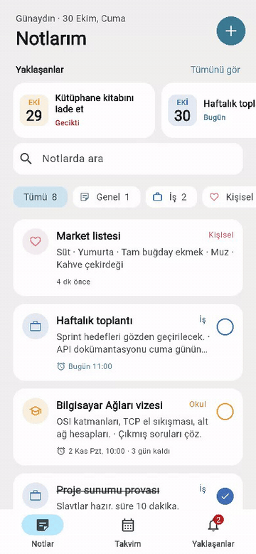
</td>
<td valign="top">

**In this recording** — real web build, real input:

1. open a note and go back
2. **+** → write a note, pick a category, **Kaydet**
3. long-press the note → **Sil**, then **Geri al**
4. **Takvim** and **Yaklaşanlar** tabs

**Notes**

- create, edit and delete — deleting offers **undo** instead of a confirmation dialog
- **categories** with their own colour and icon; add your own (**+ Yeni kategori**)
- **filter** by category and **search** title, text and category — Turkish-aware, so `iş`, `İŞ` and `IS` match
- **long-press menu** (Düzenle / Sil), as in the prototype; asks before discarding **unsaved changes**

**Reminders**

- optional **date and time** on any note, with a countdown: "Bugün 11:00", "3 gün kaldı", **Gecikti**
- a round **check** to tick a reminder off
- **Takvim**: month view with a coloured dot per reminder, and the chosen day on a **timeline**
- **Yaklaşanlar**: grouped into Gecikenler · Bugün · Yarın · Bu hafta · Daha sonra; a badge counts what needs attention
- **phone notifications** on Android and iOS when a reminder is due

**Everywhere**: a greeting by time of day, and **light and dark** themes that follow the system.

</td>
</tr>
</table>

<br>

## The assignment

UNIDEV Software gave this as the take-home task for a **mobile app developer** role (June 2025): a simple,
user-friendly note app for iOS and Android. The project report I submitted listed the requirements — here
is where each one is now:

| Requirement (from the report) | Where it is |
|---|---|
| Add, edit and delete notes | [`notes_controller.dart`](lib/notes_controller.dart), [`note_edit_screen.dart`](lib/screens/note_edit_screen.dart) |
| Categories (tags) for notes | category chips in the editor and on every card |
| *(optional)* Search by content or category | search field on the home screen |
| iOS and Android from one codebase, with Flutter | builds for Android, iOS **and web** in CI |
| Local storage with Hive or SharedPreferences | [`hive_note_store.dart`](lib/data/hive_note_store.dart) |
| Home: list, category tag on each note, **+** button, long-press → Edit / Delete | [`notes_tab.dart`](lib/screens/notes_tab.dart), [`note_actions.dart`](lib/widgets/note_actions.dart) |
| Add/Edit: title, content, category, Save | [`note_edit_screen.dart`](lib/screens/note_edit_screen.dart) |
| *(optional)* User-defined categories | **+ Yeni kategori** |
| Material Design; simple, high-contrast UI | Material 3, colours from the prototype (see below) |
| *(extra)* Dark mode | follows the system setting |
| *(extra)* Reminder notifications | dates on notes, calendar, upcoming list, phone notifications — see [Reminders](#reminders) |

Not built: Google Drive sync and colour coding by priority, the last optional extras from the report.

<br>

## Screens

| Notlar | Takvim | Yaklaşanlar | Reminder in the editor |
|:---:|:---:|:---:|:---:|
| 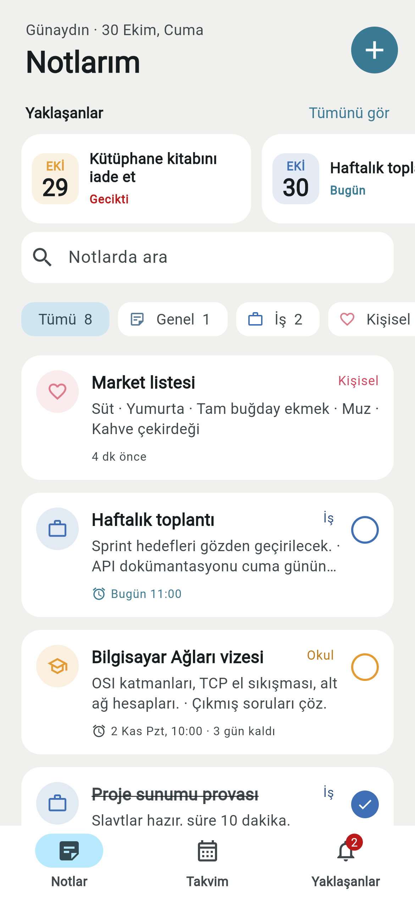 | 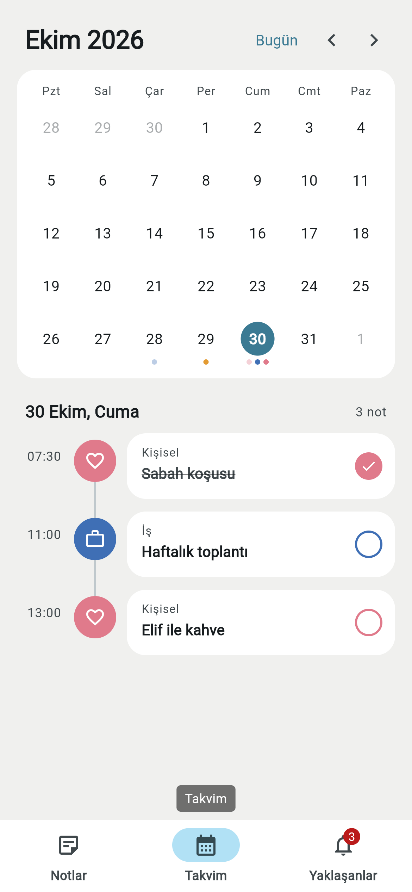 | 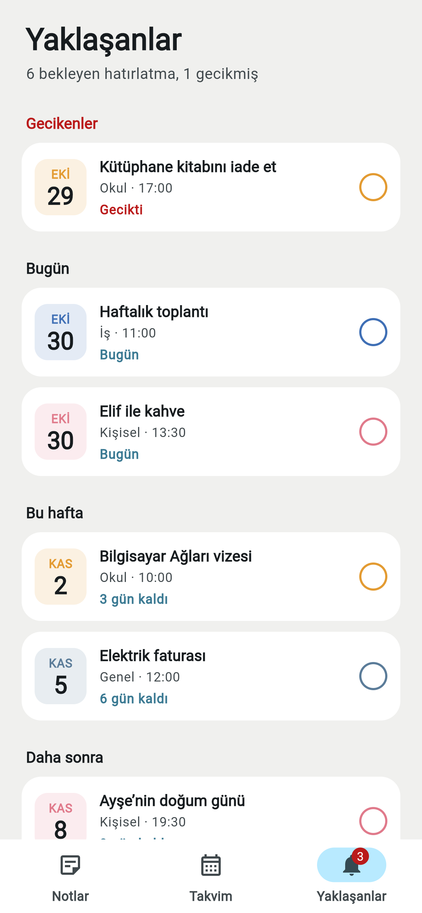 | 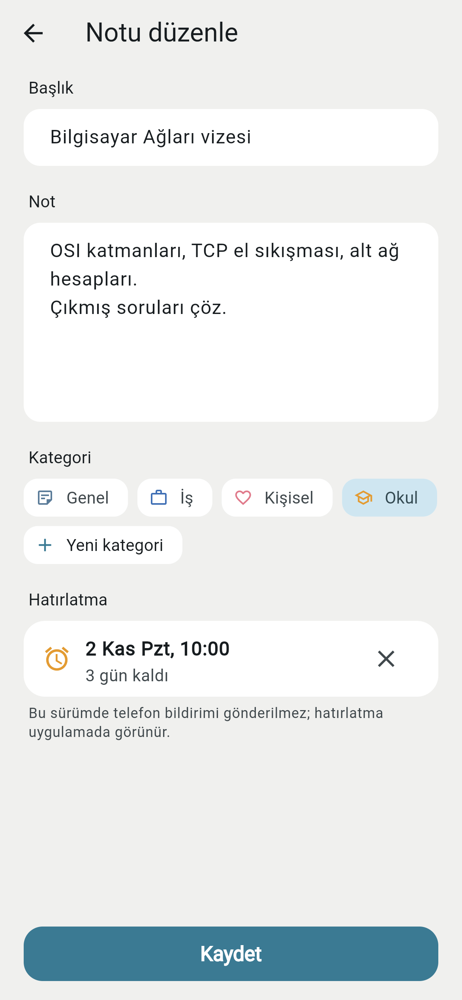 |
| **Note** | **New note** | **Long press** | **Filtered: Okul** |
| 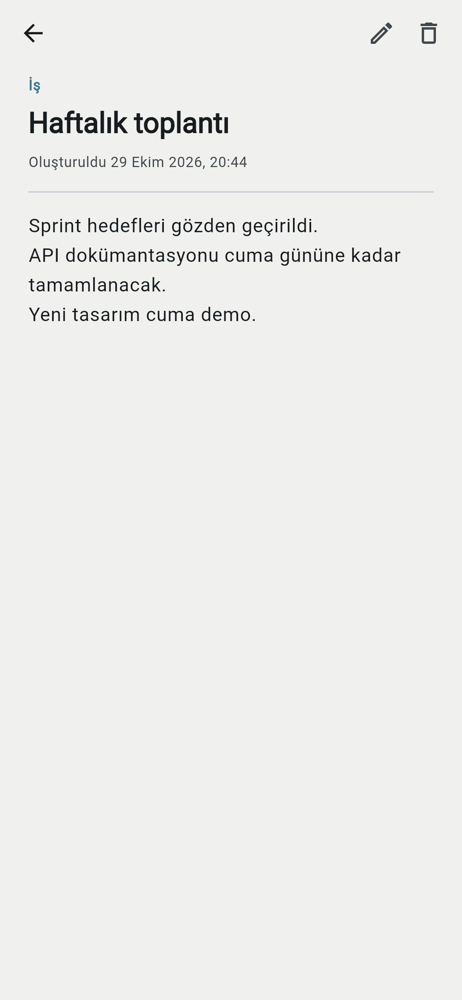 | 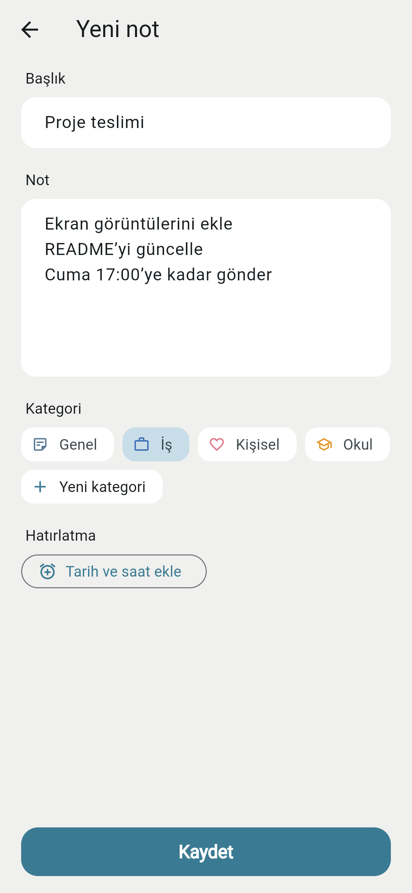 | 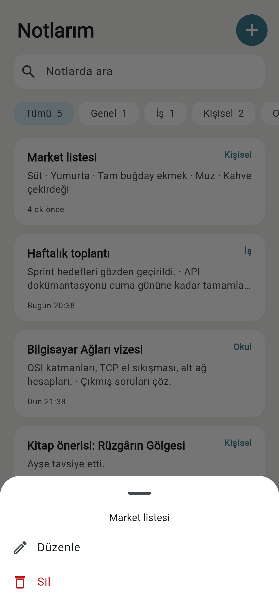 | 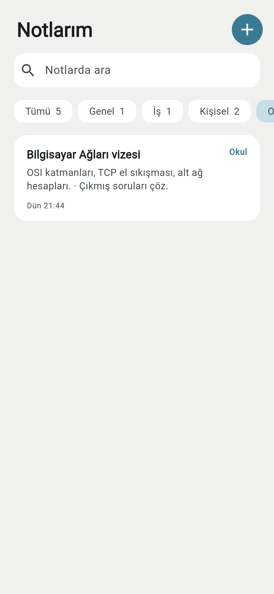 |
| **Dark** | **First launch** | | |
| 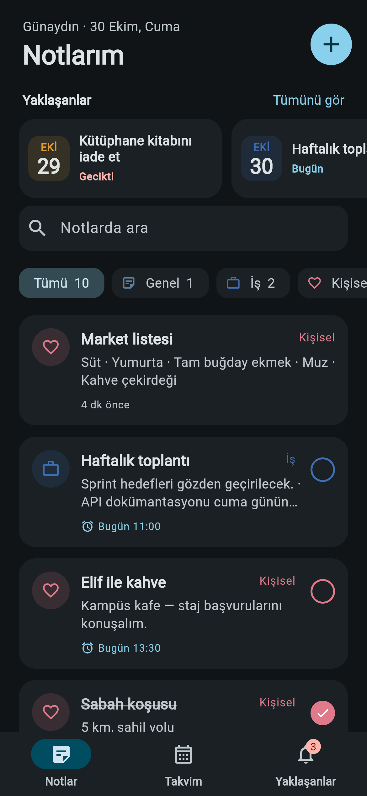 | 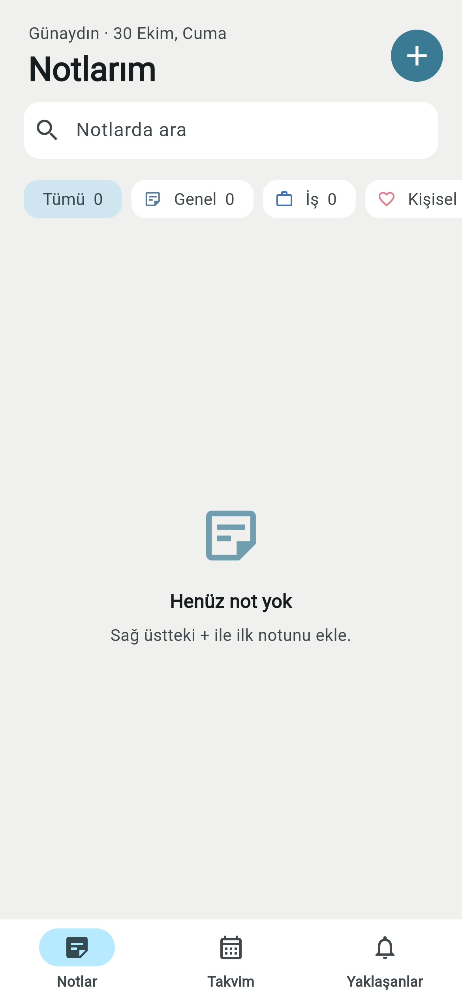 | | |

<sub>All screenshots and the recording are taken automatically from the web build by
<a href="tool/screenshots.mjs"><code>tool/screenshots.mjs</code></a> (Playwright) in CI.</sub>

<br>

## From prototype to app

The submission included a UI prototype. The app follows its layout — the soft grey page, white rounded
cards with the category on the right, the **+** in the header, full-width **Save** and the Edit / Delete menu.

| Prototype (June 2025) | App |
|:---:|:---:|
| 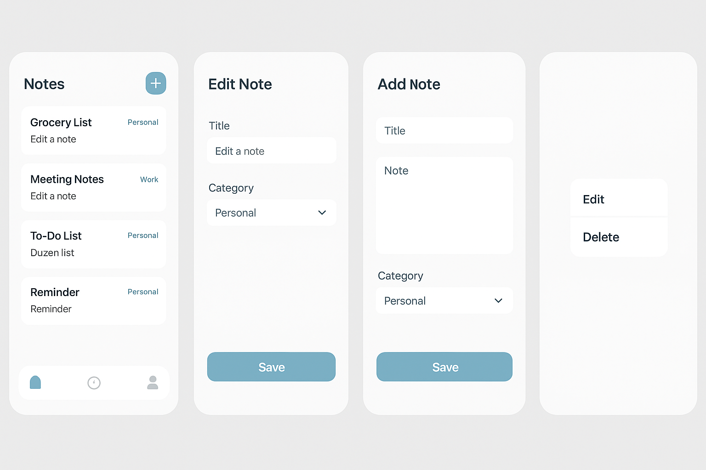 |  |

The reminder features added later (October 2026) take their cues from popular planner and reminder apps:
coloured category icons, a calendar with dots, a day timeline with round checks, and date tiles with
countdowns.

One deliberate change: the prototype's accent (`#7AAFC4`) is too light for white text (about 2.4 : 1
contrast), so buttons use a darker shade of the same blue-green (`#3B7A93`, about 4.8 : 1) to meet the
WCAG AA guideline for readable text.

<br>

## Reminders

A reminder is an optional `dueAt` date and a `done` flag on the note — not a separate kind of object, so any
note can become a reminder and back.

- **In the app** everywhere: countdown on the card, dots in the calendar, the Yaklaşanlar list and a badge on
  its tab (overdue reminders plus those due later today).
- **On the phone**, `NotesController` asks a `Reminders` service to keep a notification in step after every
  change: saving schedules it, ticking it off, deleting the note or moving the date into the past cancels it,
  and undo brings it back. On Android and iOS this is
  [`flutter_local_notifications`](https://pub.dev/packages/flutter_local_notifications); permission is asked
  the first time you add a date, not when the app opens. The time is scheduled as an absolute instant, so no
  time-zone database is needed, and with *inexact* scheduling the app needs no "exact alarm" permission — a
  notification may arrive a few minutes late.
- **On the web** browsers can't schedule a notification for later, so reminders appear in the app only —
  the editor says so.

## How it works

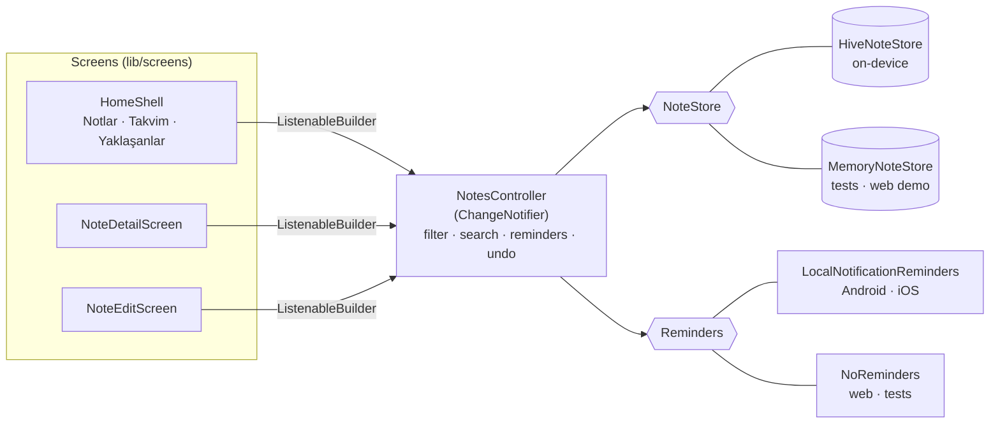

- **One source of truth.** Every screen listens to `NotesController`; an edit made in the editor shows up on
  the detail page and in the list without passing results between routes.
- **Storage and notifications behind interfaces.** `NoteStore` has two implementations — Hive for the app,
  in-memory for the widget tests and the `?demo=1` web demo — and so does `Reminders`. No state-management package is needed for an app
  this size — `ChangeNotifier` and `ListenableBuilder` come with Flutter.
- **Immutable notes.** `Note` is an immutable value with `copyWith`; the controller replaces it on edit.
  Undo simply puts the same object back.
- **Turkish-aware search.** `foldForSearch` treats İ / I / ı / i as one letter before comparing. Dart's
  `toLowerCase` doesn't follow Turkish rules (it lowers `I` to `i`, never `ı`), so a plain comparison
  would miss matches such as `IŞIK` and `ışık`.

### Older notes still open

The original app saved notes in a Hive box called `notes` with type id 0, as three strings and integer keys.
Later versions keep the box name and type id, and `NoteAdapter` writes a marker string first (`v2`, then
`v3` when reminders were added) — so when it reads a note, it can tell the formats apart and load older notes
without a migration step. On start, `HiveNoteStore` gives each version 1 note an id and re-saves it. Tests
write notes with the **original v1 adapter** and with the v2 format, and check that the current version reads,
edits and saves them.

<br>

## Run it

You need the [Flutter SDK](https://docs.flutter.dev/get-started/install) (stable channel, Dart 3.7 or newer).

```bash
git clone https://github.com/sayko89/UNIDEV---Mobile-Notes-App.git
cd UNIDEV---Mobile-Notes-App
flutter pub get
flutter run                      # on a connected phone, emulator or simulator
flutter run -d chrome            # in the browser
```

To open the web version with sample notes, add `?demo=1` to its address (and `&theme=dark` for dark mode).

<br>

## Tests and CI

```bash
flutter test
```

54 tests: the note model, dates and countdowns; the controller (create, edit, delete and undo, filters,
Turkish search, categories, reminder lists, ticking off, and that notifications are scheduled and cancelled
at the right moments); Hive storage including notes written by versions 1 and 2; and widget tests that tap
through the real screens on a phone-sized display — adding, editing, deleting with undo, filtering,
searching, the unsaved-changes dialog, adding a category, the calendar and its timeline, the upcoming list,
and setting and removing a reminder.

On every push, [GitHub Actions](.github/workflows/ci.yml) checks formatting, runs `flutter analyze` and the
tests, then builds a **release APK**, an **iOS** app (without code signing) and the **web** version.
The APK can be downloaded from the run's artifacts.

<br>

## Then and now

The version submitted in June 2025 is kept on the
[`original-submission`](https://github.com/sayko89/UNIDEV---Mobile-Notes-App/tree/original-submission) branch.
In October 2026 I rebuilt it:

| Original | Now |
|---|---|
| Code only inside a zip; one 158-line `main.dart` | 23 files in `lib/` — model, storage, reminders, controller, screens, widgets |
| No `android/`, `ios/` or `web/` folders — could not be run | Platform projects included; CI builds all three |
| `pubspec.yaml` required Dart < 3.0, which current Flutter cannot build | Dart 3.7+, maintained `hive_ce` package |
| README listed filtering, dates, a detail screen and SQLite — none were in the code | All implemented (storage is Hive, as the report said) |
| Report said filtering was added and the app was tested on simulators | 54 automated tests; builds verified in CI |
| Empty notes could be saved; delete had no undo | Empty notes refused; undo on delete; unsaved-changes prompt |
| No long-press menu, although the prototype had one | Long-press → Düzenle / Sil |
| Categories fixed to three | Add your own; each has a colour and icon |
| Reminders were a "suggestion" in the report | Dates, calendar, upcoming list and phone notifications |

<br>

---

<sub>Flutter · Dart · <a href="https://pub.dev/packages/hive_ce">hive_ce</a> ·
<a href="https://pub.dev/packages/flutter_local_notifications">flutter_local_notifications</a>. README hero set in
<a href="https://github.com/sharanda/manrope">Manrope</a> (SIL Open Font License, see <a href="tool/fonts"><code>tool/fonts</code></a>),
composed by <a href="tool/make_hero.py"><code>tool/make_hero.py</code></a> from the real screenshots.
The assignment was set by UNIDEV Software; this repository is my own work and is not affiliated with the company.</sub>
