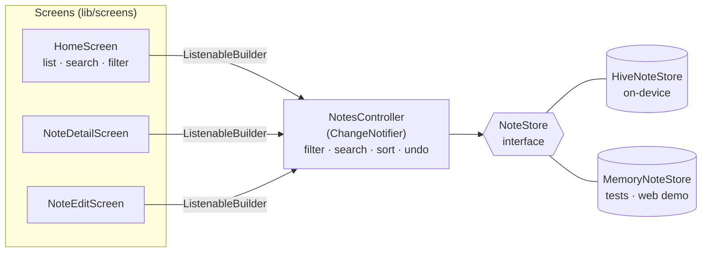

<p align="center">
  
</p>

<p align="center">
  <b>UNIDEV Software &nbsp;·&nbsp; Mobile App Developer Assignment &nbsp;·&nbsp; 2025</b><br>
  <sub>My solution to UNIDEV's mobile developer take-home task, later rebuilt into a complete, tested app.</sub>
</p>

<p align="center">
  <a href="https://github.com/sayko89/UNIDEV---Mobile-Notes-App/actions/workflows/ci.yml"></a>
</p>

<h3 align="center">
  <a href="https://sayko89.github.io/UNIDEV---Mobile-Notes-App/?demo=1">▶&nbsp; Try it in your browser</a>
</h3>
<p align="center"><sub>The web demo opens with sample notes that live only in your browser tab. Without <code>?demo=1</code> it is the real app and saves to your browser.</sub></p>

<p align="center">
  <a href="#the-assignment">The assignment</a> &nbsp;·&nbsp;
  <a href="#screens">Screens</a> &nbsp;·&nbsp;
  <a href="#from-prototype-to-app">Prototype → app</a> &nbsp;·&nbsp;
  <a href="#how-it-works">How it works</a> &nbsp;·&nbsp;
  <a href="#run-it">Run it</a> &nbsp;·&nbsp;
  <a href="#then-and-now">Then and now</a>
</p>

<br>

**UNIDEV Notlar** is a note-taking app written in **Flutter**, from one codebase for **Android, iOS and the
web**. Write a note, give it a category, find it again with search or a category filter, and edit or delete
it — with undo. Notes are stored on the device with **Hive**, so the app works offline and needs no account.
The interface is in Turkish.

<table>
<tr>
<td width="38%" valign="top">

</td>
<td valign="top">

**In this recording** — real web build, real input:

1. open a note and go back
2. **+** → write a note, pick a category, **Kaydet**
3. long-press the note → **Sil**
4. **Geri al** brings it back

**What the app does**

- create, edit and delete notes — deleting offers **undo** instead of a confirmation dialog
- **categories**: three to start with, plus your own (**+ Yeni kategori**)
- **filter** by category, with a count on each chip
- **search** title, text and category — Turkish-aware, so `iş`, `İŞ` and `IS` all match
- created and edited **dates**, shown as "4 dk önce", "Dün 21:38", …
- **long-press menu** (Düzenle / Sil), as in the prototype
- asks before throwing away **unsaved changes**
- empty notes are refused; **light and dark** theme follow the system

</td>
</tr>
</table>

<br>

## The assignment

UNIDEV Software gave this as the take-home task for a **mobile app developer** role (June 2025): a simple,
user-friendly note app for iOS and Android. The project report I submitted listed the requirements — here
is where each one is now:

| Requirement (from the report) | Where it is |
|---|---|
| Add, edit and delete notes | [`notes_controller.dart`](lib/notes_controller.dart), [`note_edit_screen.dart`](lib/screens/note_edit_screen.dart) |
| Categories (tags) for notes | category chips in the editor and on every card |
| *(optional)* Search by content or category | search field on the home screen |
| iOS and Android from one codebase, with Flutter | builds for Android, iOS **and web** in CI |
| Local storage with Hive or SharedPreferences | [`hive_note_store.dart`](lib/data/hive_note_store.dart) |
| Home: list, category tag on each note, **+** button, long-press → Edit / Delete | [`home_screen.dart`](lib/screens/home_screen.dart), [`note_actions.dart`](lib/widgets/note_actions.dart) |
| Add/Edit: title, content, category, Save | [`note_edit_screen.dart`](lib/screens/note_edit_screen.dart) |
| *(optional)* User-defined categories | **+ Yeni kategori** |
| Material Design; simple, high-contrast UI | Material 3, colours from the prototype (see below) |
| *(extra)* Dark mode | follows the system setting |

Not built: the other optional extras from the report — Google Drive sync, reminder notifications and colour
coding by priority.

<br>

## Screens

| Notes | Note | Edit | Long press |
|:---:|:---:|:---:|:---:|
|  |  |  |  |
| **Filtered: Okul** | **Dark** | **First launch** | |
|  |  |  | |

<sub>All screenshots and the recording are taken automatically from the web build by
<a href="tool/screenshots.mjs"><code>tool/screenshots.mjs</code></a> (Playwright) in CI.</sub>

<br>

## From prototype to app

The submission included a UI prototype. The app follows its layout — the soft grey page, white rounded
cards with the category on the right, the **+** in the header, full-width **Save** and the Edit / Delete menu.

| Prototype (June 2025) | App |
|:---:|:---:|
|  |  |

One deliberate change: the prototype's accent (`#7AAFC4`) is too light for white text (about 2.4 : 1
contrast), so buttons use a darker shade of the same blue-green (`#3B7A93`, about 4.8 : 1) to meet the
WCAG AA guideline for readable text.

<br>

## How it works



- **One source of truth.** Every screen listens to `NotesController`; an edit made in the editor shows up on
  the detail page and in the list without passing results between routes.
- **Storage behind an interface.** `NoteStore` has two implementations: Hive for the app, and an in-memory
  one for the widget tests and the `?demo=1` web demo. No state-management package is needed for an app
  this size — `ChangeNotifier` and `ListenableBuilder` come with Flutter.
- **Immutable notes.** `Note` is an immutable value with `copyWith`; the controller replaces it on edit.
  Undo simply puts the same object back.
- **Turkish-aware search.** `foldForSearch` treats İ / I / ı / i as one letter before comparing. Dart's
  `toLowerCase` doesn't follow Turkish rules (it lowers `I` to `i`, never `ı`), so a plain comparison
  would miss matches such as `IŞIK` and `ışık`.

### Notes from version 1 still open

The original app saved notes in a Hive box called `notes` with type id 0, as three strings and integer keys.
Version 2 keeps the box name and type id, and its `NoteAdapter` writes a marker string first — so when it
reads a note, it can tell the two formats apart and load old notes without a migration step. On start,
`HiveNoteStore` gives each old note an id and re-saves it. A test writes notes with the **original v1
adapter** and checks that version 2 reads, edits and saves them.

<br>

## Run it

You need the [Flutter SDK](https://docs.flutter.dev/get-started/install) (stable channel, Dart 3.7 or newer).

```bash
git clone https://github.com/sayko89/UNIDEV---Mobile-Notes-App.git
cd UNIDEV---Mobile-Notes-App
flutter pub get
flutter run                      # on a connected phone, emulator or simulator
flutter run -d chrome            # in the browser
```

To open the web version with sample notes, add `?demo=1` to its address (and `&theme=dark` for dark mode).

<br>

## Tests and CI

```bash
flutter test
```

35 tests: the note model and date formatting; the controller (create, edit, delete and undo, filters,
Turkish search, categories); Hive storage including notes written by version 1; and widget tests that tap
through the real screens — adding, editing, deleting with undo, filtering, searching, the unsaved-changes
dialog and adding a category.

On every push, [GitHub Actions](.github/workflows/ci.yml) checks formatting, runs `flutter analyze` and the
tests, then builds a **release APK**, an **iOS** app (without code signing) and the **web** version.
The APK can be downloaded from the run's artifacts.

<br>

## Then and now

The version submitted in June 2025 is kept on the
[`original-submission`](https://github.com/sayko89/UNIDEV---Mobile-Notes-App/tree/original-submission) branch.
In October 2026 I rebuilt it:

| Original | Now |
|---|---|
| Code only inside a zip; one 158-line `main.dart` | 16 files in `lib/` — model, storage, controller, screens, widgets |
| No `android/`, `ios/` or `web/` folders — could not be run | Platform projects included; CI builds all three |
| `pubspec.yaml` required Dart < 3.0, which current Flutter cannot build | Dart 3.7+, maintained `hive_ce` package |
| README listed filtering, dates, a detail screen and SQLite — none were in the code | All implemented (storage is Hive, as the report said) |
| Report said filtering was added and the app was tested on simulators | 35 automated tests; builds verified in CI |
| Empty notes could be saved; delete had no undo | Empty notes refused; undo on delete; unsaved-changes prompt |
| No long-press menu, although the prototype had one | Long-press → Düzenle / Sil |
| Categories fixed to three | Add your own |

<br>

---

<sub>Flutter · Dart · <a href="https://pub.dev/packages/hive_ce">hive_ce</a>. README hero set in
<a href="https://github.com/sharanda/manrope">Manrope</a> (SIL Open Font License, see <a href="tool/fonts"><code>tool/fonts</code></a>),
composed by <a href="tool/make_hero.py"><code>tool/make_hero.py</code></a> from the real screenshots.
The assignment was set by UNIDEV Software; this repository is my own work and is not affiliated with the company.</sub>
